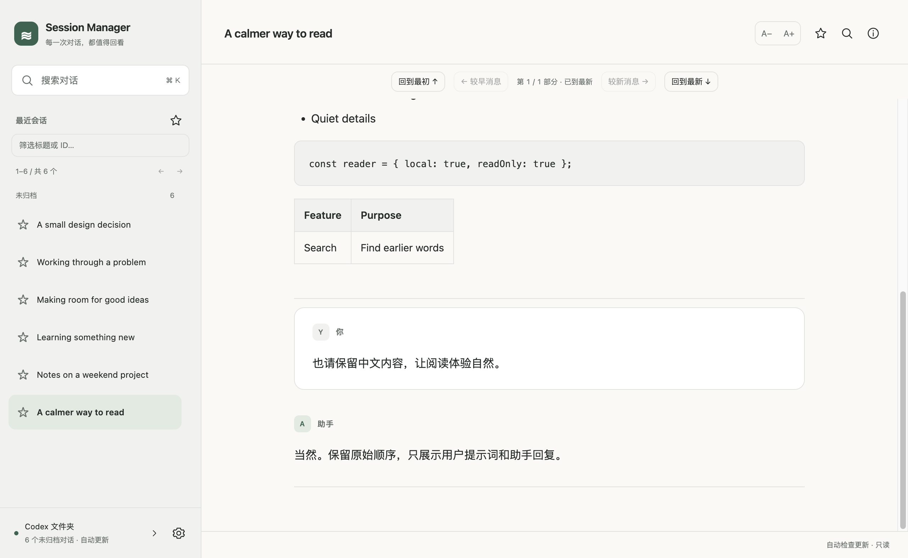

# AI Session Manager

**给好对话，一个值得回来的地方。**

在 Mac 上安静地回看 Codex 对话：找到自己的提示词和最终回复，搜索过去的答案，保留原始聊天文件。

[产品网站](https://session-manager.outerepoch3.chatgpt.site) · [下载 Mac 版](https://github.com/liyunhui0707/session-manager/releases/latest) · [使用指南](docs/user-guide.md) · [更新记录](CHANGELOG.md) · [English](docs/README.en.md)



## 为回看而设计

- **直接读取本地 Codex**：首次启动尝试 `~/.codex`，之后记住你选择的来源。
- **只保留阅读需要的内容**：展示提示词与最终回复，隐藏已识别的后台任务和过程消息。已归档对话不出现在列表中。
- **从最新开始**：打开会话即到末尾；向前翻页接着看较早消息，也能一键回到最初。
- **找到曾经的答案**：跨会话正文搜索、结果翻页、命中定位，以及当前部分查找。
- **按自己的节奏阅读**：浅色、深色、跟随系统，14–26 px 正文字号、阅读宽度和收藏。
- **本地图片预览**：关联仍存在的受支持截图，点击放大查看；找不到原图时明确提示。

无需应用账户，不调用 AI 服务，不上传聊天内容。日常浏览和搜索不会修改原始会话。也支持阅读已有 Codex / Claude Markdown 导出库；Claude 原生会话接入不在当前版本范围内。

## 下载与安装

当前提供 **Apple Silicon（M 系列芯片）Mac** 安装包，要求 **macOS 12 或更新版本**。Intel Mac 用户可从源码构建；暂不提供已验收的 Intel 下载包。

1. 从 [GitHub Releases](https://github.com/liyunhui0707/session-manager/releases/latest) 下载 `.dmg`。
2. 打开磁盘映像，将 **AI Session Manager** 拖入“应用程序”。
3. 启动应用；已有本地 Codex 记录时会自动加载，也可以选择其他来源。

当前版本 **0.11.2** 修复从下往上阅读时，图片首次加载推移正文的问题，并保持主动关闭状态。支持多窗口阅读，可把不同会话放到不同 macOS 桌面。

**当前发行包未使用 Apple Developer ID 签名，也未公证。** macOS 可能阻止首次打开。确认来自本仓库后，可按系统提示在“系统设置 → 隐私与安全性”中选择“仍要打开”。不需要关闭系统安全保护；详细说明见 [安装指南](docs/installation.md)。

更新时下载新版、正常退出旧版，再替换“应用程序”中的 App。阅读设置保留，聊天源文件不变。**当前没有应用内自动安装更新**；签名、公证和自动更新列在后续计划中。

## 隐私与边界

- 聊天文件留在本机；应用没有遥测或云同步。
- 来源路径、收藏和阅读设置保存在本机应用数据目录。
- 只有 Markdown 库的显式“刷新导入”会写入导出文件，普通阅读不写入聊天文件。
- 很长的会话首次打开、首次搜索仍需扫描；读取不完整时会提示，不会假装内容完整。
- 支持的图片是仍可访问的本地静态 PNG / JPEG，最大 8 MiB、2400 万像素；不下载远程图片，不恢复已经删除的临时截图。

完整说明：[隐私](docs/privacy.md) · [读取与搜索](docs/user-guide.md) · [安全问题反馈](SECURITY.md)

## 多窗口阅读

按 **⌘N**、点击侧栏“＋”，或选择“文件 → 新建窗口”，在同一来源下开启独立窗口。右键会话可选择“在新窗口打开”。每个窗口独立阅读、翻页和搜索；收藏与外观设置共享。可以通过 macOS 调度中心把窗口放到不同桌面。

关闭窗口不会关闭其他窗口；退出应用会关闭全部窗口，下次启动恢复来源，但不恢复多窗口布局。

## 从源码运行

需要 macOS、Node.js 24 和 Apple Command Line Tools。首次安装工具可运行 `xcode-select --install`。

```sh
git clone https://github.com/liyunhui0707/session-manager.git
cd session-manager/apps/desktop
npm ci
npm run dev
```

验证与打包：

```sh
npm run test:ci
npm run audit:prod
npm run audit:release
npm run pack
npm run dist:mac
```

`dist:mac` 会自动准备并校验 Electron 运行时，首次下载需要网络；无需先启动开发版。同版本 DMG / ZIP 已存在时会停止，请先移走要保留的旧产物。

打包使用当前机器的架构，产物位于 `apps/desktop/dist/`。不要使用 ARM 构建机生成含 ARM 原生辅助程序的 Intel 包。发布流程会在对应架构的构建机分别构建。完整依赖审计同时覆盖随 App 分发的 Electron；[已评估的构建依赖告警](docs/dependency-audit.md)单独记录。

## 参与与支持

欢迎通过 [Issues](https://github.com/liyunhui0707/session-manager/issues) 反馈问题或提出改进。请使用虚构示例，避免上传聊天记录、完整本机路径或凭据。

[贡献指南](CONTRIBUTING.md) · [架构](docs/architecture.md) · [发布流程](docs/releasing.md) · [路线图](docs/roadmap.md)

本项目独立维护，与 OpenAI 或 Anthropic 没有隶属关系。采用 [MIT 许可证](LICENSE)。
